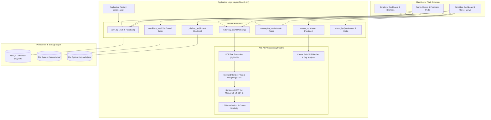

# Job Sansar: AI-Powered Semantic Job Matching & Career Exploration Platform

[](https://www.python.org/)
[](https://flask.palletsprojects.com/)
[](https://www.sqlalchemy.org/)
[](https://pytorch.org/)
[](https://www.sbert.net/)

> **Academic Notice:** This project was developed as a collaborative Final-Year Academic Capstone Project completed by a two-member team in partial fulfillment of the academic requirements at **Padmakanya College, Tribhuvan University, Nepal**.

---

## 1. Project Overview

Traditional recruitment platforms often rely on syntactic keyword matching, which suffers from vocabulary mismatch, polysemy, and an inability to understand contextual qualifications. Qualified candidates are frequently overlooked simply because their resumes phrase skills differently from employer job descriptions.

**Job Sansar** resolves this limitation by providing an intelligent, bilateral job matching and career exploration platform. The system processes full Curriculum Vitae (CV) and Job Requirement PDF documents, extracts context-rich technical sections, and transforms unstructured text into dense semantic vector representations using **Sentence-BERT (`all-MiniLM-L6-v2`)**. By calculating cosine similarity in a shared 384-dimensional latent embedding space, Job Sansar accurately ranks candidate-to-job compatibility. In addition to bilateral matching between candidates and employers, the platform features a domain-segmented **Career Path Predictor** that evaluates self-reported competencies against industry benchmarks, identifies skill gaps, and projects career advancement.

---

## 2. Objectives

* **Semantic Resume-to-Job Alignment:** Replace keyword filtering with transformer-based sentence embeddings to evaluate semantic alignment between candidates and vacancies.
* **Domain-Specific Segmentation:** Partition recruitment and career trajectories across 10 defined industry verticals (Engineering, Information Technology, Healthcare, Education, Finance, Marketing, Design, Sales, Legal, Operations/Management) to optimize recommendation quality.
* **Role-Based Workflow Management:** Deliver distinct, secure dashboards tailored to Candidates, Employers (Job Givers), and System Administrators.
* **Bilateral Interaction:** Facilitate end-to-end recruitment actions, including document uploads, embedded PDF previews, talent shortlisting, job bookmarking, and direct interview invitations.
* **Career Path Prediction & Gap Analysis:** Enable candidate skill evaluation against industry roles, computing alignment tiers and surfacing missing competencies.

---

## 3. Key Features

### Candidate Portal
* **CV Management:** Upload and manage resumes in PDF format with automatic storage handling, metadata tracking, and in-browser preview via embedded document viewports.
* **Semantic Job Match Discovery:** Automated matching against active job requirements within the candidate's domain, displaying match percentages and ranked results.
* **Job Bookmarking (`Saved Jobs`):** Asynchronous one-click job bookmarking for tracking opportunities of interest.
* **Direct Application Submission:** One-click job application generating immediate notification entries for the employer.
* **Career Path Predictor:** Interactive tool enabling candidates to input technical competencies and experience levels to evaluate compatibility with industry roles, view salary projections, and identify missing skills.

### Employer (Job Giver) Portal
* **Job Requirement Upload:** Ingest and manage structured job description PDFs categorized by industry sector.
* **Candidate Pool Ranking:** Automated evaluation and ranking of registered candidates within the sector, filtered above a 30% baseline similarity threshold.
* **Talent Shortlisting:** Dedicated dashboard to organize and review shortlisted applicant profiles.
* **Direct Interview Invitations:** Dispatch official interview invitations directly to candidate notification feeds.

### Administrator Portal
* **Platform Telemetry:** Centralized metrics tracking total registered accounts, active job openings, and candidate CV submissions.
* **User & Content Moderation:** Role-aware user management supporting cascading data removal with deletion safeguards for the primary administrative account (`jyoti`).
* **Feedback Moderation:** System-wide feedback inbox allowing administrators to review and resolve user submissions.

---

## 4. Technology Stack

| Layer | Technology | Version | Role in Project |
| :--- | :--- | :--- | :--- |
| **Backend Framework** | Flask | 3.1.1 | WSGI routing, session lifecycle, and modular Blueprints |
| **Architecture** | Application Factory Pattern | — | Factory pattern (`create_app`) with decoupled Blueprints |
| **Database ORM** | SQLAlchemy / Flask-SQLAlchemy | 2.0.41 / 3.1.1 | Relational ORM, entity models, and referential constraints |
| **Database Driver** | PyMySQL | 1.1.1 | Pure-Python DBAPI client for MySQL / MariaDB |
| **Database Engine** | MySQL / MariaDB | 10.4+ | Relational persistence with 11 relational tables |
| **NLP & Deep Learning** | Sentence-Transformers | 2.2.2 | Dense sentence embedding generation using `all-MiniLM-L6-v2` |
| **Deep Learning Engine** | PyTorch | 2.0.1 | Underlying neural tensor computation and inference |
| **Vector Computation** | NumPy / scikit-learn | 1.24.3 / 1.3.0 | Array manipulation, L2 vector normalization, and dot-product similarity |
| **Document Processing** | PyPDF2 | 3.0.1 | Programmatic extraction of text streams from uploaded PDF files |
| **Frontend Templates** | Jinja2 | 3.1.6 | Server-rendered HTML templates with custom context processors |
| **UI & Interactivity** | CSS3 & Vanilla JavaScript | — | Custom stylesheet themes and asynchronous Fetch API requests |

---

## 5. System Architecture

Job Sansar implements a three-tier modular architecture separating client interaction, application business logic, and persistent storage:

1. **Presentation Layer:** Jinja2 server-rendered templates integrated with responsive CSS modules and asynchronous JavaScript (Fetch API) for interactive operations without page reloads.
2. **Application Layer:** Modular Flask application configured via the Application Factory pattern (`app/__init__.py`), encapsulating route logic across Blueprints (`auth`, `candidate`, `jobgiver`, `matching`, `messaging`, `career`, `admin`, `main`).
3. **AI / NLP Pipeline:** Custom inference pipeline comprising text extraction, context-aware keyword amplification, 384-dimensional dense vector embedding generation, and cosine similarity computation.
4. **Data Persistence Layer:** MySQL relational database managing entity relationships and transactional records, accompanied by a file system directory for stored PDF documents (`uploads/cvs/` and `uploads/jobs/`).



---

## 6. Technical Implementation

### 6.1 PDF Text Extraction & Context-Aware Keyword Amplification
Implemented in `ai_logic/extract_text.py`:
* **Text Extraction:** Uses `PyPDF2.PdfReader` to extract raw text streams across all document pages.
* **Keyword Matching:** Evaluates extracted text against domain-specific keyword dictionaries (`cv_keywords` and `job_keywords` covering technical skills, professional experience, projects, qualifications, and role responsibilities).
* **Context Retention & Weighting:** When a keyword is detected, the line and up to 3 subsequent context lines are captured. The primary keyword line is replicated using a `weight_multiplier=2.0` to deliberately amplify its weight in the downstream embedding representation.
* **Safe Fallback:** If no keywords match, the parser falls back to the document's initial 1,000 characters to prevent empty embeddings.

### 6.2 Semantic Vector Embeddings & Similarity Matching
Implemented in `ai_logic/vectorizer.py` and `ai_logic/matcher.py`:
* **Dense Vector Representations:** Text strings are passed to the pre-trained `all-MiniLM-L6-v2` transformer model via `sentence-transformers`, producing dense vectors in $\mathbb{R}^{384}$.
* **L2 Normalization:** Embedding vectors are normalized to unit length:
  $$\mathbf{\hat{e}} = \frac{\mathbf{e}}{\|\mathbf{e}\|_2}$$
* **Cosine Similarity:** Similarity between the target query vector $\mathbf{\hat{q}}$ and document vectors $\mathbf{\hat{d}}_i$ is computed using the dot product:
  $$\text{Sim}(\mathbf{q}, \mathbf{d}_i) = \max\left(0.0, \min\left(1.0, \mathbf{\hat{q}} \cdot \mathbf{\hat{d}}_i\right)\right)$$
* **Domain Partitioning & Thresholding:** Matches are strictly evaluated within identical industry sectors. Results below a threshold score of 0.30 (30%) are excluded; qualifying scores are converted to percentage values $[0, 100\%]$ and sorted in descending order.

### 6.3 Career Path Prediction & Skill Gap Identification
Implemented in `career_routes.py`:
* Evaluates candidate skills recorded in `user_skills` against target career role specifications stored in `career_paths`.
* Calculates percentage match scores based on string containment and token overlap against career requirements.
* Classifies candidate alignment into four tiers: **Excellent Fit** ($\ge 80\%$), **Good Fit** ($\ge 60\%$), **Moderate Fit** ($\ge 40\%$), and **Basic Fit** ($< 40\%$).
* Identifies matching versus missing skills, providing candidates with clear upskilling guidance alongside experience-weighted salary estimates.

---

## 7. Project Structure

```
Job_Sansar/
├── admin.py                  # Admin blueprint: system telemetry, moderation, cascading deletions
├── career_routes.py          # Career blueprint: skill inventory CRUD and path recommendations
├── run.py                    # Application entry point (127.0.0.1:5000, debug=True)
├── requirements.txt          # Pinned project dependencies and library versions
├── schema.sql                # SQL database schema and benchmark career path seed data
├── job_portal (1).sql        # Full database dump generated via phpMyAdmin
├── .env                      # Environment variable specifications
├── .flaskenv                 # Flask development runtime configuration
│
├── ai_logic/                 # Core AI and NLP module package
│   ├── __init__.py           # Package marker
│   ├── career_predictor.py   # Jaccard similarity and domain-adjusted career recommendation logic
│   ├── extract_text.py       # PyPDF2 text extraction with keyword context weighting
│   ├── matcher.py            # Cosine similarity calculation and ranking engine
│   └── vectorizer.py         # SentenceTransformer wrapper (all-MiniLM-L6-v2)
│
├── app/                      # Main application package
│   ├── __init__.py           # Application Factory (create_app), config, and blueprint registration
│   ├── models.py             # SQLAlchemy models (11 relational entities)
│   ├── routes/               # Modular route definitions
│   │   ├── __init__.py
│   │   ├── auth.py           # Login, registration, role checks, feedback submission
│   │   ├── candidate.py      # Candidate dashboard, CV upload/delete, job bookmarking
│   │   ├── jobgiver.py       # Employer dashboard, job requirement upload/delete, shortlists
│   │   ├── main.py           # Landing page, static informational routes, file serving
│   │   ├── matching.py       # Orchestration routes for bidirectional semantic matching
│   │   └── messaging.py      # In-app notifications, direct applications, and invitations
│   └── utils/
│       ├── __init__.py
│       └── helpers.py        # Template context processors and notification helpers
│
├── static/                   # Static web assets
│   ├── images/               # Image assets (hero illustrations)
│   └── style/                # Modular stylesheets (Orange/modern theme)
│       ├── admin_dashboard.css
│       ├── dashboard.css
│       ├── homepage.css
│       ├── inbox.css
│       ├── login.css
│       ├── matches.css
│       └── style.css
│
├── templates/                # Jinja2 HTML templates
│   ├── base.html             # Master layout with navigation and flash messages
│   ├── homepage.html         # Public landing page
│   ├── about.html            # Informational overview of Job Sansar
│   ├── privacy.html          # Privacy policy
│   ├── login.html            # Multi-role authentication interface
│   ├── register.html         # User registration interface
│   ├── contact.html          # Feedback submission form
│   ├── precandidate.html     # Candidate pre-dashboard showing active vacancies
│   ├── candidate.html        # Candidate portal for CV upload and management
│   ├── prejobgiver.html      # Employer pre-dashboard showing candidate profiles
│   ├── jobgiver.html         # Employer portal for posting job requirements
│   ├── match_results.html    # Employer match results interface
│   ├── job_matches.html      # Candidate match results interface
│   ├── shortlisted.html      # Employer shortlisted candidate roster
│   ├── saved_jobs.html       # Candidate bookmarked job listings
│   ├── inbox.html            # Notifications and interaction history
│   ├── admin/                # Administrator views
│   │   ├── dashboard.html    # Global statistics and user management table
│   │   └── feedback.html     # Feedback moderation table
│   └── career/               # Career exploration views
│       ├── predictor.html    # Interactive career match and skill gap view
│       └── skills.html       # User skill management interface
│
└── uploads/                  # Persistent filesystem document storage
    ├── cvs/                  # Uploaded candidate CV PDF files
    └── jobs/                 # Uploaded employer job requirement PDF files
```

---

## 8. Database Design

The relational database (`job_portal`) contains 11 interconnected tables enforcing referential integrity with cascading constraints:

| Table Name | Primary Key | Foreign Keys & Constraints | Description & Key Responsibilities |
| :--- | :--- | :--- | :--- |
| `users` | `id` | `UNIQUE(username)` | User credentials, roles (`candidate`, `jobgiver`, `admin`), address, company name |
| `candidate_cvs` | `id` | `user_id -> users(id)` (CASCADE) | Uploaded resume filenames, upload timestamps, and assigned domain |
| `job_requirements` | `id` | `user_id -> users(id)` (CASCADE) | Uploaded job vacancy filenames, upload timestamps, and assigned domain |
| `applications` | `id` | `candidate_id -> users(id)`, `job_id -> job_requirements(id)` | Tracks submitted applications; enforces `UNIQUE(candidate_id, job_id)` |
| `shortlists` | `id` | `jobgiver_id -> users(id)`, `cv_id -> candidate_cvs(id)` | Tracks employer shortlisted candidates; enforces `UNIQUE(jobgiver_id, cv_id)` |
| `saved_jobs` | `id` | `candidate_id -> users(id)`, `job_id -> job_requirements(id)` | Bookmarked job vacancies; enforces `UNIQUE(candidate_id, job_id)` |
| `messages` | `id` | `sender_id -> users(id)`, `receiver_id -> users(id)` | Audit trail of application notices, invitations, and file associations |
| `notifications` | `id` | `user_id -> users(id)` (CASCADE) | In-app alerts for applications, invites, and bookmarks with read status |
| `feedback` | `id` | `user_id -> users(id)` (CASCADE) | User feedback messages routed to the administrative dashboard |
| `career_paths` | `id` | — | Benchmark career profiles storing domain, salary ranges, and required skills (JSON) |
| `user_skills` | `id` | `user_id -> users(id)` (CASCADE) | Candidate skill profiles with proficiency ratings and years of experience |

---

## 9. Application Workflow

### Candidate Workflow
1. **Account Registration:** Register an account specifying the `candidate` role.
2. **Resume Submission:** Access `/candidate`, select an industry sector (e.g., *Information Technology*), and upload a PDF resume.
3. **Semantic Matching:** Click "Find Jobs" to trigger text extraction and embedding comparison against all active job postings within the same domain.
4. **Engagement:** Review matched positions with similarity percentage indicators, save roles for later review, or submit direct applications.
5. **Career Exploration:** Access `/career/career-predictor`, manage personal technical skills, and analyze compatibility across benchmark career paths to identify missing skills.

### Employer (Job Giver) Workflow
1. **Account Registration:** Register an account specifying the `jobgiver` role and company affiliation.
2. **Job Requirement Upload:** Access `/jobgiver`, select the relevant industry sector, and upload a job description PDF.
3. **Talent Discovery:** Click "Find Matches" to execute semantic ranking against all candidate resumes in that domain.
4. **Shortlisting & Invitations:** Inspect candidate CVs in the embedded viewer, shortlist candidates, or send direct interview invitations.

### Administrator Workflow
1. **Telemetry Inspection:** Access `/admin` to monitor global counts of users, active jobs, and uploaded CVs.
2. **User & Content Moderation:** Review registered users, manage listings, and execute cascading deletions if necessary.
3. **Feedback Management:** Inspect and moderate user submissions through `/admin/feedback`.

---

## 10. Installation and Setup

### Prerequisites
* **Python:** 3.10+ (tested on Python 3.13)
* **MySQL / MariaDB:** Running on `localhost:3306` (e.g., through XAMPP or native MariaDB/MySQL service)
* **Virtual Environment:** Python `venv`

### Step 1: Clone the Repository
```bash
git clone https://github.com/Jyoti-Adhikari/Job_Sansar.git
cd Job_Sansar
```

### Step 2: Create and Activate Virtual Environment
```bash
python3 -m venv venv

# On Linux/macOS:
source venv/bin/activate

# On Windows:
# venv\Scripts\activate
```

### Step 3: Install Dependencies
```bash
pip install --upgrade pip
pip install -r requirements.txt
```

> **Note on Model Download:** On the first matching request, `sentence-transformers` automatically downloads the pre-trained `all-MiniLM-L6-v2` model weights (~90 MB) to the local cache directory (`~/.cache/torch/sentence_transformers/`).

### Step 4: Database Setup
1. Ensure your local MySQL/MariaDB server is running on `localhost:3306`.
2. Create the `job_portal` database and import the schema and seed data:
   ```bash
   mysql -u root -p -e "CREATE DATABASE IF NOT EXISTS job_portal;"
   mysql -u root -p job_portal < schema.sql
   ```
   *(If your local MySQL root user has no password, omit the `-p` flag: `mysql -u root job_portal < schema.sql`).*

### Step 5: Environment Configuration
The project is pre-configured via `.env` and `app/__init__.py`. Verify that `.env` contains:
```ini
DATABASE_NAME=job_portal
DATABASE_USER=root
DATABASE_PASSWORD=
DATABASE_HOST=localhost
DATABASE_PORT=3306

FLASK_APP=run.py:app
FLASK_ENV=development
DEBUG=True

APP_NAME=Job Sansar
APP_VERSION=1.0
```

---

## 11. Running the Application

Start the Flask application using the WSGI runner:
```bash
python run.py
```
*(Alternatively, run using `flask run` via `.flaskenv`: `flask run --host=127.0.0.1 --port=5000`)*

Access the application in your browser at:
```
http://127.0.0.1:5000/
```

### Default Administrative Credentials
* **Username:** `jyoti`
* **Password:** `jyoti` *(As initialized in `schema.sql`)*
* **Role:** `admin`

---

## 12. Screenshots

Below are designated screenshot locations illustrating the implemented application interface:

* **Landing Page:**  
  ``  
  *Illustrates the public entry page, platform branding, and navigation.*

* **Candidate Dashboard & PDF Viewer:**  
  ``  
  *Displays uploaded candidate CVs with in-browser PDF previews.*

* **Semantic Match Results:**  
  ``  
  *Displays computed similarity percentages, domain tags, and action buttons.*

* **Career Path Predictor & Gap Analysis:**  
  ``  
  *Highlights suitability classifications, skill matching breakdown, and missing competencies.*

* **Employer Dashboard & Shortlists:**  
  ``  
  *Displays posted job vacancies and candidate management controls.*

* **Administrative Metrics & Moderation:**  
  ``  
  *Demonstrates platform statistics cards, user management tables, and feedback moderation.*

---

## 13. Limitations and Future Improvements

### Existing Limitations
1. **Plaintext Credential Storage:** User passwords are submitted and evaluated in plain text. A production environment requires cryptographic hashing (e.g., `bcrypt` or `argon2id`).
2. **Synchronous Inference:** Document text extraction and embedding generation execute synchronously during the HTTP request cycle, which may cause request latency under larger workloads.
3. **Document Format Support:** Document ingestion is restricted to `.pdf` files. Although `python-docx` is listed in `requirements.txt`, DOCX parsing is not yet integrated into upload routes.
4. **On-the-Fly Embedding Computation:** Embeddings are generated dynamically upon each search request rather than precomputed and stored in a persistent vector index.

### Proposed Future Improvements
1. **Asynchronous Background Processing:** Integrate **Celery** with **Redis** to offload PDF parsing and embedding generation to background task workers.
2. **Vector Indexing & Persistence:** Integrate vector search indexing tools such as **FAISS** or **pgvector** to persist document embeddings and enable low-latency approximate nearest neighbor (ANN) retrieval.
3. **Advanced Information Extraction:** Replace keyword heuristics with Named Entity Recognition (NER) models (e.g., fine-tuned BERT or spaCy) to automatically extract skills, years of experience, and educational credentials from resume text.
4. **Automated Testing Suite:** Develop comprehensive test coverage using `pytest` and `pytest-flask` to validate matching algorithms and route integrity.

---

## 14. Academic Project Information

* **Project Title:** Job Sansar – AI-Powered Semantic Job Matching & Career Exploration Platform
* **Project Type:** Final-Year Undergraduate Academic Capstone Project
* **Team Structure:** Collaborative project completed by a two-member team:
  * **Team Contributor:** Jyoti Adhikari
  * **Peer Collaborator:** *(Collaborative academic capstone team member)*
* **Institution:** Padmakanya College, Tribhuvan University, Nepal
